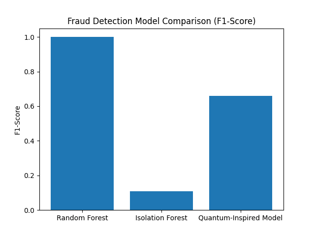
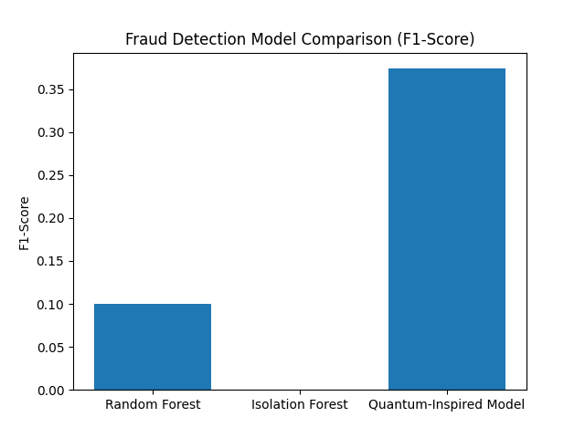

# 🔍 Quantum-Inspired Financial Fraud Detection

A college research project that explores **machine learning and quantum-inspired optimization** for detecting fraudulent credit card transactions. It compares a **Random Forest**, an **Isolation Forest** and a **quantum-inspired optimized model**, using **F1-score** as the evaluation metric.

---

## 📌 Overview

Fraud detection is difficult because fraudulent transactions are extremely rare compared to normal ones. This project handles that imbalance and compares a supervised model, an unsupervised anomaly detector and an optimization-based model on the same data.

**Pipeline:**

```
Load data → Balance classes → Train/test split → Scale features → Train 3 models → Compare F1-scores
```

---

## 🤖 Models

| Model | Type | Description |
|-------|------|-------------|
| **Random Forest** | Supervised | 100 decision trees trained on labeled transactions |
| **Isolation Forest** | Unsupervised anomaly detection | Flags unusual transactions as fraud (contamination = 0.02) |
| **Quantum-Inspired Model** | Optimization-based | Searches for the best classifier weights through random perturbations with a probabilistic acceptance rule (similar to simulated annealing), over 200 iterations, maximizing F1-score |

---

## 📊 Dataset

`creditcard.csv` is the credit card fraud dataset (anonymized features `V1`–`V28`, `Time`, `Amount`, and the label `Class` where `1` = fraud and `0` = normal).

Source: [Credit Card Fraud Detection (Kaggle)](https://www.kaggle.com/datasets/mlg-ulb/creditcardfraud)

---

## 🛠️ Tech Stack

- **Language:** Python
- **Libraries:** NumPy, Pandas, Scikit-learn, Matplotlib

---

## 📂 Project Structure

```
MLproject/
├── FinancialFraud.py    # Complete pipeline: preprocessing, models, comparison
├── creditcard.csv       # Dataset
├── Figure_1.png         # Output figure
├── Figure_2.png         # Output figure
└── README.md
```

---

## 🚀 Getting Started

### Prerequisites
- Python 3.8 or higher
- Git

### Installation

```bash
git clone https://github.com/parthasarathit5/MLproject.git
cd MLproject
pip install numpy pandas scikit-learn matplotlib
```

### Run

```bash
python FinancialFraud.py
```

The script prints the class counts, the F1-score of each model and a performance summary, and shows a bar chart comparing the models.

---

## 📈 Output





---

## 📏 Evaluation Metric

Accuracy is misleading on imbalanced data, so the models are compared using **F1-score**:

```
F1 = 2 × (Precision × Recall) / (Precision + Recall)
```

---

## 🔮 Future Improvements

- Split the data before balancing, to avoid duplicated fraud rows appearing in both train and test sets
- Add precision, recall, ROC-AUC and a confusion matrix
- Try SMOTE and other models (XGBoost, Autoencoders)
- Evaluate the optimized model on the test set
- Add cross-validation and hyperparameter tuning

---

## 👨‍💻 Author

**Partha Sarathi Talapala**
GitHub: [@parthasarathit5](https://github.com/parthasarathit5)

